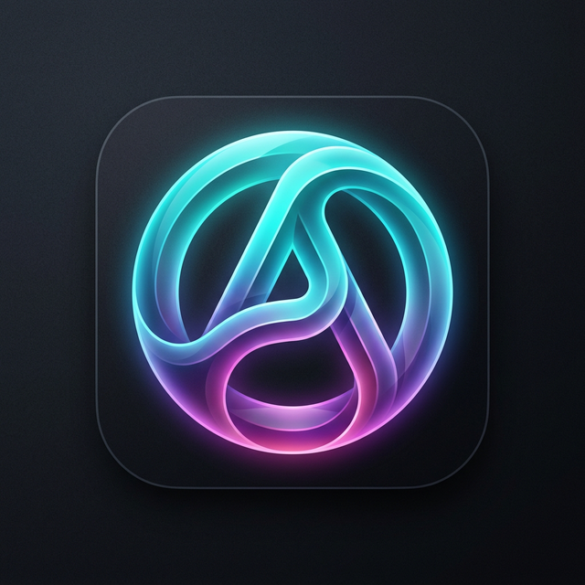

# Alenfinos Intranet 🏠

O **Alenfinos Intranet** é um aplicativo desktop construído para atuar como o sistema nervoso central de uma família. Ele agrega gestão financeira familiar, listas de tarefas com quadros Kanban, armazenamento de documentação e uma Assistente Pessoal alimentada por IA Local (Ollama) com contextos customizáveis para diferentes membros da casa.

<div align="center">
  
</div>

## 🌟 Visão Geral

O projeto substitui diversos aplicativos fragmentados por um hub central que permite a colaboração familiar, ao mesmo tempo que mantém a privacidade dos espaços individuais.

*   **Visão Geral da Casa:** Um painel consolidado com o resumo financeiro, controle de despesas/receitas da casa, projetos em andamento, tarefas coletivas e um repositório seguro de documentos (Identidade, Contratos, etc).
*   **Perfis Pessoais (Isis & Angélica):** Áreas isoladas voltadas para o controle de tarefas e finanças individuais acessíveis através da nova barra lateral.
*   **Ring IA:** Assistente baseada em LLMs (rodando via *Ollama*), capaz de responder com comportamentos e contextos personalizados definidos nas configurações de cada perfil da casa, oferecendo lembretes e ajuda nativa.
*   **Sincronização em Tempo Real:** Banco de dados alimentado por Supabase para manter tudo atualizado instantaneamente entre vários PCs.

## 🛠️ Tecnologias Utilizadas

Este projeto foi forjado utilizando ferramentas de alta performance voltadas ao desenvolvimento desktop com tecnologias web:

*   **[Tauri v2](https://v2.tauri.app/):** Motor de compilação em Rust que transforma a aplicação web em executáveis `.exe` leves e eficientes para Windows (e macOS/Linux).
*   **[React 18](https://react.dev/) + [Vite](https://vitejs.dev/):** Interface de usuário rápida com TypeScript.
*   **[Zustand](https://github.com/pmndrs/zustand):** Genrenciador de estado moderno.
*   **[Supabase](https://supabase.com/):** Backend-as-a-Service (Banco Postgres com Realtime API).
*   **[Ollama](https://ollama.ai/):** Provedor de inteligência artificial local gratuita (ex: *Llama 3.2*, *Mistral*).
*   **Lucide React:** Ícones minimalistas.

## 🚀 Como Executar e Compilar o Projeto

### 1. Pré-Requisitos

*   [Node.js](https://nodejs.org/) (versão 18+)
*   [Rust](https://www.rust-lang.org/tools/install) (Para o build do Tauri)
*   Visual Studio C++ Build Tools (Apenas para Windows)
*   [Ollama](https://ollama.com/download) (Instalado e rodando o comando `ollama run llama3.2`)

### 2. Configuração do Backend (Supabase)

Crie um projeto no Supabase, execute o script SQL que encontra-se na raiz do repositório em `supabase/migration.sql` e crie um arquivo `.env` na raiz do Frontend com as chaves geradas:

```env
VITE_SUPABASE_URL=https://seu-id.supabase.co
VITE_SUPABASE_ANON_KEY=sua-chave-anon-key
```

### 3. Execução em Modo de Desenvolvimento

Para rodar no Browser via Vite:

```bash
npm install
npm run dev
```

Para rodar a janela nativa de Debug do Tauri:

```bash
npm run tauri dev
```

### 4. Compilando para Produção (Gerar o Instalador .exe)

Para gerar a versão final para ser instalada nos PCs da casa:

```bash
npm run tauri build
```
O executável `.msi` e os `.exe` de setup poderão ser encontrados em `src-tauri/target/release/bundle/nsis/`.

---

## 📚 Documentação Adicional

Para entender a fundo a estrutura do código, roteamento e fluxos de estado, acesse a [DOCUMENTATION.md](./DOCUMENTATION.md).

## 📄 Licença

Uso pessoal — Privado.
